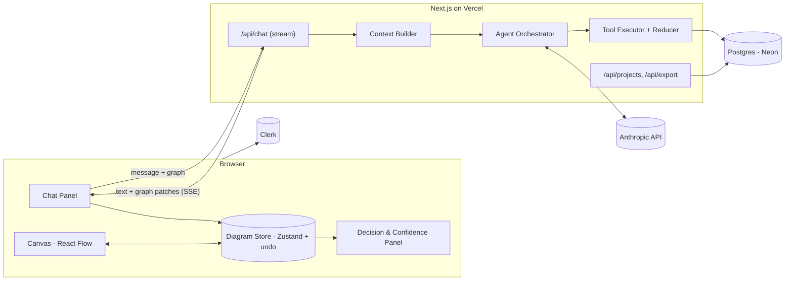
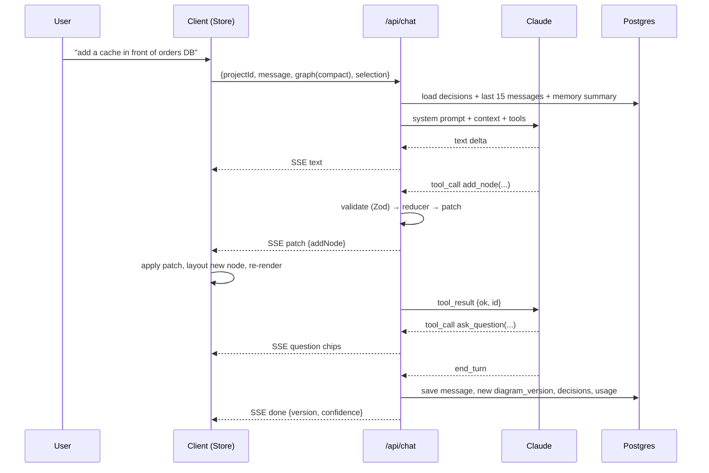

# ArchBoard — Development Plan
### "An architecture-review partner that happens to draw"

*Working name: ArchBoard (rename freely). Author: Venkat. Created: 2026-10-27.*

---

## 0. One-paragraph pitch

A web app where you describe a system in plain language and an AI architect draws it as an editable diagram, then **keeps brainstorming with you** — asking the questions a senior architect would ask, proposing alternatives, and editing the diagram incrementally as you make decisions — until you reach a design you are 100% confident in. The output is not just a picture: it is the diagram **plus a decision log** explaining why every box and arrow is there.

---

## 1. Positioning (read this before building anything)

### 1.1 What already exists (and why you don't compete on it)
| Product | What it does | Gap you exploit |
|---|---|---|
| Eraser.io (DiagramGPT) | Text → diagram, nice rendering | One-shot generation; no review loop, no decision tracking |
| Mermaid Chart AI, ChatUML | Chat → Mermaid code | Text-based source, weak interactive editing, regenerates whole diagram |
| Excalidraw AI, Whimsical AI, Lucid AI | AI inside drawing tools | AI is a "feature"; the drawing tool is the product |
| Claude / ChatGPT artifacts | Chat produces Mermaid/SVG | No persistent canvas, no manual editing that survives the next turn |

**Everyone does "text → diagram". Nobody does "diagram → questions → decisions → confidence".**

### 1.2 Your three differentiators
1. **Socratic review loop** — the AI asks about scale, failure modes, cost, security, single points of failure, and pushes back on weak choices.
2. **Incremental, edit-preserving changes** — the AI mutates the diagram with small operations; your manual edits are never thrown away.
3. **Decision log (lightweight ADRs)** — every "yes, go with X" is recorded with the reason and the rejected alternative. Exportable as a design doc.

### 1.3 Scope discipline for "any diagram type"
"Any diagram" is a trap if taken literally (Gantt, mind maps, floor plans…). Define the MVP as **any node-and-edge diagram**:
- System / cloud architecture
- Data pipelines & data platforms
- Microservice / API topology
- Infrastructure & network layouts
- Simple flowcharts and data-flow diagrams

This single data model (nodes, edges, groups) covers ~90% of what engineers draw. Sequence diagrams and ER diagrams come in Phase 4 as separate renderers.

---

## 2. Technology stack and why

**Decision: TypeScript end-to-end with Next.js.** Reasons:
- The interactive canvas (React Flow) is a JavaScript library — the heaviest part of the app lives in the browser regardless of backend language.
- One language front-to-back means one mental model, one set of types shared between the AI's tool outputs and the UI, and AI coding assistants (Copilot, Claude Code) are strongest in the TS/React ecosystem — important since you plan to build with AI help.
- Anthropic's TypeScript SDK and the Vercel AI SDK give streaming + tool calling out of the box.
- Deployment is one click (Vercel). No servers to manage for a side gig.

| Layer | Choice | Notes |
|---|---|---|
| Framework | **Next.js 15 (App Router)** | Server Actions + Route Handlers for the API |
| Language | **TypeScript** | Strict mode on from day one |
| Canvas | **React Flow (@xyflow/react)** | Drag/drop nodes, edges, groups, minimap, zoom |
| Auto-layout | **ELK.js** (fallback: dagre) | Lays out nodes the AI adds so they don't pile up |
| UI kit | **Tailwind + shadcn/ui** | Fast, good-looking defaults |
| AI | **Anthropic SDK (TS)** via **Vercel AI SDK** | `streamText` + tools; Claude Sonnet for speed, Opus for "deep review" |
| Schema validation | **Zod** | Validates every tool call the model makes before it touches state |
| State (client) | **Zustand** | Holds the graph; undo/redo stack |
| Database | **Postgres (Neon or Supabase)** + **Drizzle ORM** | Projects, diagram versions, messages, decisions |
| Auth | **Clerk** (or Auth.js) | Don't build auth yourself |
| Export | `html-to-image` (PNG/SVG), custom Mermaid serialiser | |
| Hosting | **Vercel** | Preview deploys per branch |
| Payments (later) | **Stripe** | Phase 5 |
| Repo | GitHub, PR-based workflow | Use Claude Code / Copilot agent mode |

---

## 3. System architecture

```
Browser (Next.js client)
 ├── Chat panel  ──► POST /api/chat (streaming)
 ├── Canvas (React Flow)  ◄── graph store (Zustand)
 ├── Decision log panel
 └── Export menu
            │
            ▼
Next.js server (Route Handlers / Server Actions)
 ├── /api/chat        → builds prompt (system + graph snapshot + history) → Claude (streaming, tools)
 ├── tool executor    → validates tool calls (Zod) → applies ops to graph → returns new graph
 ├── /api/projects    → CRUD
 └── /api/export      → Mermaid / Markdown design doc
            │
            ▼
Postgres (Neon/Supabase)
 ├── users, projects
 ├── diagram_versions (full JSON snapshot per turn — cheap, enables time travel)
 ├── messages (chat history)
 └── decisions (ADR records)
```

> Full High-Level Design is in §16 and Low-Level Design in §17.

### 3.1 The golden rule
**The diagram is data (JSON), never a picture and never Mermaid text.** Rendering is a projection of the JSON. Mermaid, PNG and SVG are exports. This is what makes edit-preservation and undo possible.

### 3.2 Request flow for one chat turn
1. User types "add a cache in front of the orders DB".
2. Client sends message + **current graph JSON** (compact form) + last N messages.
3. Server assembles system prompt (role, rules, tool definitions) and calls Claude with tools.
4. Claude streams text and emits tool calls like `add_node`, `add_edge`, `ask_question`, `record_decision`.
5. Server validates each tool call, applies it to a copy of the graph, streams the **graph patch** to the client.
6. Client applies the patch to Zustand, runs ELK layout *only for new nodes* (existing positions untouched), re-renders.
7. New diagram version + messages + decisions saved to Postgres.

---

## 4. Core data model

```ts
// graph.ts — the single source of truth
type NodeKind = "service" | "database" | "queue" | "cache" | "storage" | "api"
             | "client" | "external" | "function" | "job" | "generic";

interface DiagramNode {
  id: string;            // stable, e.g. "n_orders_db" — AI chooses readable ids
  label: string;
  kind: NodeKind;        // drives icon/shape
  tech?: string;         // "PostgreSQL", "Kafka", "Azure Function"
  groupId?: string;      // containment (VPC, region, "Data Platform")
  position?: { x: number; y: number }; // set by layout or user drag
  notes?: string;        // hover text
  tags?: string[];       // "pii", "critical-path"
}

interface DiagramEdge {
  id: string;
  source: string; target: string;
  label?: string;        // "REST", "CDC", "publishes"
  style?: "solid" | "dashed";
  direction?: "one" | "both";
}

interface DiagramGroup { id: string; label: string; parentId?: string; }

interface Decision {         // lightweight ADR
  id: string;
  title: string;             // "Use Kafka for order events"
  decision: string;
  reasoning: string;
  alternatives: string[];    // rejected options
  relatedNodeIds: string[];
  status: "proposed" | "accepted" | "superseded";
  createdAt: string;
}

interface Diagram {
  nodes: DiagramNode[]; edges: DiagramEdge[]; groups: DiagramGroup[];
  decisions: Decision[];
  openQuestions: string[];   // what the AI is still unsure about
  confidence: number;        // 0–100, AI-estimated, see §6
}
```

**Versioning:** store a full JSON snapshot per turn in `diagram_versions`. Diagrams are small (KBs); diffing is premature optimisation. This gives you undo, "compare with 3 turns ago", and branching ("what if we went serverless?") for free.

---

## 5. The AI agent design

### 5.1 Roles
- **Architect** (default, Claude Sonnet): converses, draws, asks questions.
- **Reviewer** (on demand, Claude Opus): "Review my design" → structured critique against a checklist (§6).

### 5.2 Tools the model can call (all Zod-validated)
| Tool | Purpose |
|---|---|
| `add_node({label, kind, tech?, groupId?, notes?})` | Add one component |
| `update_node({id, patch})` | Rename, retag, change tech |
| `remove_node({id})` | Also removes attached edges |
| `add_edge({source, target, label?, style?})` | Connect components |
| `remove_edge({id})` | |
| `add_group({label, nodeIds, parentId?})` | Create a boundary / region |
| `record_decision({title, decision, reasoning, alternatives, relatedNodeIds})` | Write an ADR |
| `ask_question({question, options?, why})` | Surface a decision the user must make (rendered as clickable chips) |
| `set_confidence({score, blockers[]})` | Update the confidence meter and what's blocking 100% |
| `replace_diagram({nodes, edges, groups})` | **Only** for the first draft from an empty canvas |

**Why many small tools instead of "regenerate the diagram":** small ops preserve the user's layout and manual edits, produce reviewable patches, cost fewer tokens, and let you stream the diagram changing live.

### 5.3 System prompt — the behaviours that matter
- You are a senior architect, not a drawing assistant. Draw first, then **ask one or two sharp questions** per turn (not ten).
- Prefer editing over redrawing. Never remove something the user added unless asked.
- When the user makes a choice, call `record_decision`. When you make an assumption, say so and list it under open questions.
- Review checklist to probe over time: scale & load, failure modes & retries, data consistency, security & auth boundaries, cost, observability, single points of failure, deployment/CI, data privacy (PII).
- Keep confidence honest: it only goes up when open questions are closed.

### 5.4 Context management
- Always send the full current graph (compact JSON, ids + labels + edges) — it's the ground truth, not the chat history.
- Keep the last ~15 messages; summarise older history into a short "project memory" paragraph (stored in DB) when it exceeds the window.
- Decisions list is always included (it's short and it's what stops the model re-litigating settled choices).

### 5.5 Safety rails
- Reject tool calls referencing unknown node ids (model hallucinates ids occasionally) — return an error message to the model and let it retry.
- Cap tool calls per turn (e.g. 25) to prevent runaway loops.
- Every applied patch is reversible (undo stack).

---

## 6. The "100% confidence" loop (your core feature)

A visible **confidence meter** (0–100) with a **blockers list**. Confidence is a product of:
1. **Open questions** closed (each `ask_question` answered or dismissed).
2. **Review checklist** coverage — the Reviewer pass marks each area ✅ / ⚠️ / ❌ with a one-line finding.
3. **Decisions recorded** for every non-obvious choice.

User journeys:
- *"Review my design"* → Reviewer runs, adds findings as open questions, lowers/raises confidence.
- *"I'm happy with this"* → app checks for unresolved ❌ items and asks "are you sure? these 2 blockers remain".
- *Lock* → diagram is frozen as a version, design doc is generated.

This loop is the thing to demo. Everything else is table stakes.

---

## 7. Canvas & rendering notes
- Custom React Flow node per `kind` (icon + label + tech badge). Start with simple shapes; cloud-provider icon packs (AWS/Azure/GCP) come in Phase 3.
- Groups → React Flow parent nodes with `extent: "parent"`.
- Layout: run ELK on the whole graph for the first draft; afterwards only position **new** nodes near their neighbours. Provide a manual "Re-layout" button.
- Click a node → side panel with notes, tech, tags, and "ask AI about this component".
- Select nodes + type in chat → the selection ids are passed as context ("make *these* highly available").

---

## 8. Exports
1. **PNG / SVG** of the canvas.
2. **Mermaid** (`flowchart`) serialised from JSON — for pasting into READMEs.
3. **JSON** (import/export of the whole project).
4. **Design doc (Markdown)**: overview, diagram image, component table, decision log, open questions, review findings. This is the "deliverable" users will pay for.

---

## 9. Phased plan

Timelines assume evenings/weekends with AI-assisted coding. Adjust freely.

### Phase 0 — Foundations (Week 1)
- [ ] Create repo, Next.js + TS strict + Tailwind + shadcn + ESLint/Prettier.
- [ ] Add React Flow with a hard-coded 5-node sample diagram; drag works.
- [ ] Define `graph.ts` types + Zod schemas. Write 10 unit tests for the op reducer (`applyOp(diagram, op) → diagram`).
- [ ] Anthropic key in `.env.local`; hello-world streaming chat route.
- **Exit criterion:** you can drag boxes and stream a Claude reply in the same page.

### Phase 1 — Core loop MVP (Weeks 2–4)
- [ ] Tool definitions (§5.2) wired to the reducer; patches stream to the canvas.
- [ ] System prompt v1; first-draft generation via `replace_diagram`.
- [ ] `ask_question` rendered as clickable option chips in chat.
- [ ] `record_decision` → decision panel.
- [ ] ELK auto-layout for new nodes; manual re-layout button.
- [ ] Undo/redo (Zustand + version stack, in-memory).
- [ ] Local persistence (localStorage) — **no DB or auth yet**.
- **Exit criterion:** 30-minute brainstorm of a real system (e.g. your Warm Leads pipeline) ends with a diagram you'd actually keep, without the AI ever clobbering a manual edit.

### Phase 2 — Persistence & accounts (Weeks 5–6)
- [ ] Postgres (Neon) + Drizzle schema: users, projects, diagram_versions, messages, decisions.
- [ ] Clerk auth; projects list page.
- [ ] Version history with "restore" and "compare".
- [ ] Deploy to Vercel; share links (read-only).
- **Exit criterion:** 5 friends/colleagues use it on their own designs; collect feedback.

### Phase 3 — The confidence product (Weeks 7–9)
- [ ] Confidence meter + blockers panel (`set_confidence`).
- [ ] Reviewer mode (Opus) with checklist output.
- [ ] Design-doc Markdown export; Mermaid & PNG export.
- [ ] Cloud icon packs (AWS/Azure/GCP) for node kinds.
- [ ] Prompt evaluation harness: 10 scripted scenarios, check the model produces valid ops and asks sensible questions (regression safety when you change prompts).
- **Exit criterion:** demo video of the full loop; landing page live.

### Phase 4 — Breadth (Weeks 10–13)
- [ ] Sequence diagram renderer (separate data model, same chat loop).
- [ ] ER diagram renderer.
- [ ] Import from Mermaid text (parse → JSON) to pull existing diagrams in.
- [ ] Templates (3-tier web app, event-driven, lakehouse, RAG system).
- [ ] "What-if" branches (fork a version and explore an alternative side by side).
- [ ] **RAG & templates (embeddings enter here, not before):** embed ~100 reference-architecture descriptions and the user's past decision logs (pgvector in Neon); retrieve the 3 closest when starting a project or when the user asks "how did I handle X before". Later: embed cloud-provider docs so Reviewer cost/limit advice is grounded.

### Phase 5 — Monetisation (Week 14+)
- [ ] Stripe: Free (3 projects, Sonnet only) / Pro (unlimited, Reviewer mode, exports).
- [ ] Usage metering (tokens per user) and rate limits.
- [ ] Team workspaces (later, only if demand).

---

## 10. Repo structure (starting point)

```
archboard/
  app/
    (marketing)/page.tsx
    (app)/projects/[id]/page.tsx      # canvas + chat + decisions
    api/chat/route.ts                 # streaming + tools
    api/export/route.ts
  components/
    canvas/        # ReactFlow wrapper, custom nodes, groups
    chat/          # messages, question chips, streaming
    decisions/     # ADR panel
    confidence/    # meter + blockers
  lib/
    graph/types.ts, schemas.ts, reducer.ts, layout.ts, mermaid.ts
    ai/system-prompt.ts, tools.ts, context.ts
    db/schema.ts, queries.ts
  store/diagram.ts                    # Zustand + undo
  tests/graph/reducer.test.ts
  evals/scenarios/*.json              # prompt regression scenarios
```

---

## 11. Risks and mitigations
| Risk | Mitigation |
|---|---|
| Model regenerates / clobbers user edits | Small-op tools only; `replace_diagram` disabled once the canvas is non-empty |
| Hallucinated node ids | Validate every op; send error back to model for a retry |
| Layout looks ugly after many additions | ELK incremental placement + manual re-layout; don't over-invest early |
| Chat becomes "ten questions per turn" and annoying | Prompt rule: max 2 questions per turn; eval harness checks this |
| Token cost per session | Compact graph serialisation; Sonnet by default, Opus only on explicit review |
| You're new to React/TS | Phase 0 is deliberately tiny; use AI pair-programming; learn React Flow via its official examples first |
| Scope creep from "any diagram" | Node-edge only until Phase 4 |

---

## 12. Rough cost model (side-gig sanity check)
- Vercel hobby/pro: $0–20/mo. Neon: $0–19/mo. Clerk: free tier to start.
- Claude API: a 30-minute session ≈ 20 turns × ~6k input + 1k output tokens → a few cents on Sonnet; Reviewer (Opus) pass ≈ 10–30¢. A Pro user at $12/mo doing 10 sessions is comfortably profitable.

---

## 13. Metrics to watch from Phase 2
- Sessions that reach "Lock" / ≥90 confidence (the activation metric).
- Average turns per session; questions answered vs dismissed.
- Edits made manually vs by AI (healthy = both).
- Exports generated (design doc exports = willingness-to-pay signal).

---

## 14. First-week checklist (start here)
1. `npx create-next-app@latest archboard --typescript --tailwind --app`
2. `npm i @xyflow/react elkjs zustand zod ai @ai-sdk/anthropic`
3. Render the React Flow "basic" example; replace nodes with your own `DiagramNode` type.
4. Write `reducer.ts` with `addNode`, `addEdge`, `removeNode` + tests.
5. Build `/api/chat` streaming hello-world with the Vercel AI SDK.
6. Wire a single tool (`add_node`) end to end: type "add a Postgres database" → a node appears.
7. Commit. Everything after this is iteration.

---

## 16. High-Level Design (HLD)

### 16.1 Goals and non-functional requirements
| Requirement | Target (MVP) |
|---|---|
| First token latency on a chat turn | < 2 s |
| Diagram patch applied live while streaming | yes — user sees nodes appear mid-reply |
| Diagram size | up to ~150 nodes / 300 edges without layout or token pain |
| Availability | Vercel + Neon managed; no self-hosted servers |
| Data | one tenant per user; projects private by default; read-only share links |
| Security | API key server-side only; auth on every route; per-user rate limits |
| Cost ceiling | < $0.10 per average session on Sonnet |

### 16.2 Component view



**Responsibilities**
- **Chat Panel** — sends messages, renders streamed text, question chips, applies incoming patches to the store.
- **Canvas** — pure projection of the store; emits manual edits (drag, rename, delete) back into the store as ops.
- **Diagram Store** — the single `Diagram` object + undo/redo stack. Every change, human or AI, is an *op* applied through the same reducer.
- **Context Builder** — assembles system prompt + compact graph + decisions + recent messages within a token budget.
- **Agent Orchestrator** — runs the model/tool loop (via Vercel AI SDK), enforces caps, chooses model (Sonnet / Opus).
- **Tool Executor + Reducer** — validates each tool call (Zod), applies it, returns result to the model, emits patch to the client.
- **Projects/Export API** — CRUD, version history, Mermaid/Markdown/JSON export.

### 16.3 Deployment view
```
GitHub (main / feature branches)
   └─► Vercel: preview URL per PR, production on main
         ├─ Next.js server functions (region: closest to users; start with US-East or Singapore)
         ├─ Env: ANTHROPIC_API_KEY, DATABASE_URL, CLERK_*  (never in client bundle)
         └─► Neon Postgres (same region)   └─► Anthropic API   └─► Clerk
Custom domain → Vercel. Observability: Vercel logs + a per-turn `usage` row (tokens, model, latency, cost).
```

### 16.4 End-to-end flow of one turn



### 16.5 Key design decisions (project ADRs)
| # | Decision | Why | Rejected |
|---|---|---|---|
| 1 | Diagram is JSON; Mermaid/PNG are exports | edit-preservation, undo, diffs | Mermaid as source of truth |
| 2 | AI edits via small ops, not regeneration | user edits survive; streamable; cheap | `regenerate_diagram` each turn |
| 3 | Full snapshot per version | diagrams are KBs; simplicity | event-sourced diffs |
| 4 | Same reducer for human and AI edits | one code path, one test suite | separate canvas mutation logic |
| 5 | Sonnet default, Opus for review | cost vs quality where it matters | Opus everywhere |
| 6 | Server owns the agent loop | API key safety, caps, logging | client-side calls to Anthropic |
| 7 | Managed services (Vercel/Neon/Clerk) | side-gig; zero ops | self-hosted containers |

---

## 17. Low-Level Design (LLD)

### 17.1 Module map and responsibilities
| Module | Exports | Depends on |
|---|---|---|
| `lib/graph/types.ts` | `Diagram`, `DiagramNode`, `DiagramEdge`, `DiagramGroup`, `Decision`, `Op` | — |
| `lib/graph/schemas.ts` | Zod schemas for every type and every `Op` | types |
| `lib/graph/reducer.ts` | `applyOp(d, op): Result<Diagram, OpError>`, `applyOps`, `invert(op, before): Op` | types, schemas |
| `lib/graph/layout.ts` | `layoutAll(d)`, `placeNewNodes(d, newIds)` (ELK) | types |
| `lib/graph/mermaid.ts` | `toMermaid(d): string` | types |
| `lib/graph/serialize.ts` | `toCompact(d): string` (for the model), `fromCompact` | types |
| `lib/ai/tools.ts` | tool definitions (name, Zod params, executor) | schemas, reducer |
| `lib/ai/system-prompt.ts` | `buildSystemPrompt(mode: "architect" \| "reviewer")` | — |
| `lib/ai/context.ts` | `buildContext({diagram, decisions, messages, selection, memory})` with token budget | serialize |
| `lib/ai/orchestrator.ts` | `runTurn(input): AsyncIterable<StreamEvent>` | tools, context, prompt, AI SDK |
| `lib/ai/models.ts` | `MODELS = { architect: "claude-sonnet-5-5", reviewer: "claude-opus-5-5" }` | — |
| `lib/db/schema.ts` | Drizzle tables | — |
| `lib/db/queries.ts` | `getProject`, `saveVersion`, `appendMessage`, `upsertDecision`, `logUsage` | schema |
| `store/diagram.ts` | Zustand: `diagram`, `apply(op)`, `undo()`, `redo()`, `selection` | reducer |
| `app/api/chat/route.ts` | POST handler: auth → rate limit → `runTurn` → SSE | orchestrator, queries |

### 17.2 The `Op` type (the contract between human, AI and storage)
```ts
type Op =
  | { type: "addNode";    node: DiagramNode }
  | { type: "updateNode"; id: string; patch: Partial<Omit<DiagramNode,"id">> }
  | { type: "removeNode"; id: string }
  | { type: "addEdge";    edge: DiagramEdge }
  | { type: "removeEdge"; id: string }
  | { type: "addGroup";   group: DiagramGroup; nodeIds: string[] }
  | { type: "moveNode";   id: string; position: {x:number;y:number} }   // human only
  | { type: "recordDecision"; decision: Decision }
  | { type: "setConfidence"; score: number; blockers: string[] }
  | { type: "addQuestion"; question: OpenQuestion }
  | { type: "resolveQuestion"; id: string; answer?: string }
  | { type: "replaceDiagram"; nodes: DiagramNode[]; edges: DiagramEdge[]; groups: DiagramGroup[] }; // empty canvas only
```
Rules enforced in `applyOp`:
- `addNode` with existing id → `DUPLICATE_ID`; AI tool executor regenerates id from label (`n_` + slug + counter).
- `addEdge` with unknown source/target → `UNKNOWN_NODE` (returned to the model as a tool error).
- `removeNode` cascades edges and group membership.
- `replaceDiagram` rejected unless `nodes.length === 0` → `CANVAS_NOT_EMPTY`.
- `setConfidence` clamps 0–100 and cannot exceed `100 - 10 * unresolvedBlockingQuestions`.
- Reducer is **pure** (returns new object, never mutates) — this is what makes undo trivial: `invert(op, before)` produces the reverse op.

### 17.3 Tool definitions (shape passed to the model)
Each tool = `{ name, description, parameters: ZodSchema, execute(params, ctx) }` where `execute` maps params → `Op` → `applyOp` → returns `{ ok: true, ...ids }` or `{ ok: false, error, hint }`. The `hint` is written for the model ("node id 'n_orders' not found; known ids: n_api, n_orders_db …").

Executor guards:
- `MAX_TOOL_CALLS_PER_TURN = 25` → further calls return `{ok:false, error:"LIMIT"}` and the loop is stopped.
- Same op repeated identically twice in a turn → ignored (model retry loops).
- All ops of a turn are collected into `turnOps[]` for the version record.

### 17.4 Streaming protocol (server → client, SSE over the AI SDK stream)
| event | payload | client action |
|---|---|---|
| `text` | `{delta}` | append to assistant bubble |
| `patch` | `{op}` | `store.apply(op)` (no undo entry per AI op; one grouped entry per turn) |
| `question` | `{id, question, options[], why}` | render chips; selection sends a user message `"Answer <id>: <option>"` |
| `confidence` | `{score, blockers[]}` | update meter |
| `error` | `{code, message}` | toast; keep diagram state (never roll back on error) |
| `done` | `{versionId, usage}` | enable input, refresh history list |

### 17.5 Context builder algorithm
```
budget = 24k tokens (Sonnet) / 40k (Opus review)
1. system prompt (fixed, ~1.2k)
2. compact graph: "NODES: id|label|kind|tech|group ... EDGES: src->tgt|label ..."   (~15 tokens/node)
3. decisions: title + one-line decision (cap 30; oldest summarised)
4. open questions (all)
5. selection: ids the user has highlighted, if any
6. memory summary paragraph (if present)
7. messages: newest first until budget hit (min 6, max 15)
If still over budget → drop node `notes`, then truncate memory summary, then reduce messages.
When messages exceed 15 → trigger async summariser (Sonnet) to refresh memory summary.
```

### 17.6 Database schema (Drizzle / Postgres)
```sql
users(id pk, clerk_id unique, email, created_at)
projects(id pk, user_id fk, name, current_version_id, memory_summary text, created_at, updated_at)
diagram_versions(id pk, project_id fk, seq int, diagram jsonb, ops jsonb, created_by enum('user','ai'), created_at)
messages(id pk, project_id fk, role enum('user','assistant','tool'), content text, tool_calls jsonb, version_id fk null, created_at)
decisions(id pk, project_id fk, title, decision, reasoning, alternatives jsonb, related_node_ids jsonb, status, created_at, updated_at)
usage(id pk, user_id fk, project_id fk, model, input_tokens, output_tokens, cost_usd numeric, latency_ms, created_at)
share_links(id pk, project_id fk, token unique, read_only bool, expires_at)
-- indexes: diagram_versions(project_id, seq desc); messages(project_id, created_at); usage(user_id, created_at)
```
`decisions` is also embedded inside `diagram.decisions` in each version snapshot; the table exists for querying/export and is the write-through copy.

### 17.7 Confidence state machine
```
DRAFTING ──(user: "review my design")──► REVIEWING (Opus) ──► DRAFTING (findings added as questions)
DRAFTING ──(user: "I'm happy")──► if blockingQuestions == 0 → LOCKED (frozen version + design doc)
                                  else → CONFIRM_BLOCKERS (show list; "lock anyway" allowed, flagged in doc)
LOCKED ──(user edits)──► DRAFTING (new version; previous stays locked in history)
```
Confidence score = model-proposed via `setConfidence`, then clamped by reducer rule in §17.2.

### 17.8 Canvas internals
- Node component per `kind`: icon + label + tech badge; memoised; `data` is the `DiagramNode`.
- Store → React Flow mapping is a pure selector (`toFlowNodes(diagram)`); React Flow never owns state.
- Manual drag end → `moveNode` op; label edit → `updateNode`; delete key → `removeNode`.
- `placeNewNodes`: for each new node, run ELK on the subgraph of (node + its direct neighbours) and place relative to the neighbour centroid; existing positions are pinned.
- Groups → parent nodes; child `extent: "parent"`; group resize recomputed from children on each patch.

### 17.9 API contracts
```
POST /api/chat        body {projectId, message, selection?:string[], mode?:"architect"|"reviewer"} → SSE
GET  /api/projects    → [{id,name,updatedAt,confidence}]
POST /api/projects    body {name} → {id}
GET  /api/projects/:id/versions?limit=20 → [{id,seq,createdBy,createdAt}]
POST /api/projects/:id/restore body {versionId} → {newVersionId}
GET  /api/export/:id?format=mermaid|md|json → file
POST /api/share/:id   → {url}
All routes: Clerk auth; /api/chat rate limit 30 turns/hour/user (Upstash or in-DB counter).
```

### 17.10 Error handling & retries
- Model returns invalid JSON params → Zod error sent back as tool result; model retries (max 2 per tool call).
- Anthropic 429/529 → exponential backoff ×3, then `error` event; diagram state untouched.
- Stream drops mid-turn → client keeps applied patches; `done` never arrives → client calls `GET versions` to resync to last saved version.
- DB write fails after a successful turn → ops kept in client memory; retry save with the same `turnId` (idempotent).

### 17.11 Testing strategy
- **Unit:** reducer (every op, every error code, invert/undo round-trip); serializer; mermaid export.
- **Contract:** each tool's Zod schema against sample model outputs (fixtures).
- **Integration:** `/api/chat` with a mocked model emitting scripted tool calls → assert patches and saved version.
- **Evals (Phase 3):** 10 scenario transcripts against the real model; assert ≥95% valid tool calls, ≤2 questions per turn, no `replaceDiagram` on non-empty canvas, confidence never rises while blockers exist.

---

## 18. Open questions for you to decide (before Phase 1)
- Name and domain.
- Free tier limits (projects / turns per day).
- Whether cloud-vendor icons are needed in the MVP or later (recommendation: later).
- Whether to allow fully manual drawing from a blank canvas without AI (recommendation: yes, it's cheap once React Flow is in).
