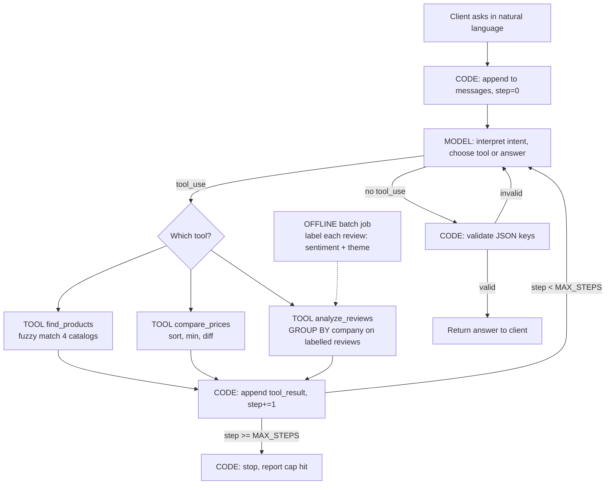

# Product Price & Review Comparison Agent

A learn-by-building agentic AI project. A client asks about a product in natural
language; an agent loop (raw Anthropic API, no framework) uses three read-only
tools to find the product across four companies, compare prices, and summarise
reviews company-wise, then returns an answer in a fixed format.

**Companies (v1):** Amazon, Flipkart, Croma, Reliance Digital — electronics.
*(Replace with your final four; all four must sell overlapping products.)*

**Data (v1):** synthetic — 100 products per company, 100 reviews per product.

---

## 1. Is this an agent? (Phase 0)

- As a fixed sequence (search → prices → reviews → format) it is a **pipeline**, not an agent.
- It becomes an **agent** because the client's question varies and the model must choose a different path through the same tools each time.
- Test questions that prove the loop is real:

| Question | Expected tool path |
|---|---|
| "Is the A54 cheaper on Flipkart or Amazon?" | `find_products` → `compare_prices` |
| "What do people complain about with the A54?" | `find_products` → `analyze_reviews` |
| "Compare A54 and Pixel 7a" | `find_products` ×2 → `compare_prices` → `analyze_reviews` |
| "Which one is on Amazon?" (follow-up) | memory from messages list, maybe `find_products` |
| "Compare the XYZ-9000" (does not exist) | `find_products` returns `[]` → agent says not found, no retry loop |

---

## 2. Design (Phase 1)

| Item | Decision |
|---|---|
| **Goal / done** | Final answer returned in the fixed JSON format. **Code** validates the required keys — the model does not decide it is done. `MAX_STEPS = 8` as backstop. |
| **Tools** | Exactly three, read-only (see §3). Tools pass **product IDs** between them, not names. |
| **Memory** | Within-run only — the `messages` list. No persistent store in v1. |
| **Knowledge / RAG** | Not needed. Data is local CSVs. |
| **Embeddings** | **Not in v1.** `rapidfuzz` fuzzy matching inside `find_products`. Add embeddings later only for cross-company entity resolution, if fuzzy visibly fails. |
| **Guardrails** | None — nothing sends, writes, deletes or buys. |
| **Reviews cost control** | Sentiment + theme labelled **offline** in a batch job before the agent runs. `analyze_reviews` is then a GROUP BY company, returning aggregates + 3 sample reviews per company. |
| **Success criteria** | 8–10 test questions; for each: correct tools called, cheapest price matches CSV, JSON validates. |

### Final output format (what the model must return)

```json
{
  "product": "Samsung Galaxy A54 5G",
  "matches": [{"company": "Amazon", "product_id": "AMZ-0042", "name": "...", "price": 34999}],
  "cheapest": {"company": "Flipkart", "price": 33490, "saves_vs_most_expensive": 1710},
  "review_summary": {
    "Amazon":   {"n": 100, "positive_pct": 61, "negative_pct": 29, "top_complaints": ["battery", "delivery"]},
    "Flipkart": {"n": 100, "positive_pct": 74, "negative_pct": 16, "top_complaints": ["packaging"]}
  },
  "recommendation": "..."
}
```

---

## 3. Tool contracts

```
find_products(query: str)
  -> list[{company, product_id, name, price, rating}]
  Searches all four catalogs with fuzzy matching. Returns [] on no match (never raises).

compare_prices(product_ids: list[str])
  -> {rows: [{company, product_id, name, price}], cheapest: {company, price}, saves_vs_most_expensive}
  Pure Python arithmetic. No LLM.

analyze_reviews(product_ids: list[str])
  -> {company: {n, positive_pct, negative_pct, top_themes, sample_reviews: [3]}}
  GROUP BY company over pre-labelled reviews. No LLM at run time.
```

Defensive paths every tool must handle: no match, product on only some companies, product with zero reviews, bad/unknown product_id.

---

## 4. Flow



### Same flow as a trace (example: "Is the A54 cheaper on Amazon or Flipkart, and what are people complaining about?")

1. **[code]** Loop starts: client message → `messages`, `step = 0`, sends `messages` + 3 tool definitions to the model.
2. **[model]** Understands the language (any language), extracts the product, replies with `tool_use: find_products(query="Samsung Galaxy A54")`.
3. **[code]** Dispatches: calls the Python function, appends `tool_result`, `step = 1`, calls the model again.
4. **[tool]** `find_products` → 3 rows with IDs (Amazon, Flipkart, Croma); Reliance Digital returns nothing — fine.
5. **[model]** Has IDs → `tool_use: compare_prices([...])`.
6. **[tool]** `compare_prices` → sorted rows, cheapest = Flipkart.
7. **[model]** → `tool_use: analyze_reviews([...])`.
8. **[tool]** `analyze_reviews` → per-company positive/negative %, top complaints, 3 samples. "Amazon more negative than Flipkart" is computed here.
9. **[model]** No more tools needed → final JSON answer, no `tool_use` block.
10. **[code]** Loop exits, validates JSON keys, prints. Total: 3 tool calls, 4 model calls.

### Division of labour

- **Model does only:** interpret intent → decide next tool or stop → write the final answer.
- **Code / tools do:** the loop, dispatch, all arithmetic, all filtering, all aggregation, validation, `MAX_STEPS`, logging, error handling.
- Rule: *computable answer → code; judgement about meaning → model.*

---

## 5. Build order (Phase 2)

1. `generate_data.py` — synthetic product + review CSVs (ingestion)
2. `label_reviews.py` — offline sentiment + theme labelling, writes `reviews_labelled.csv` (enrichment ETL)
3. Raw model call — prove `ANTHROPIC_API_KEY` works
4. Agent loop with `find_products` only — watch one tool call happen
5. Add `compare_prices`, then `analyze_reviews`
6. Run the test questions in §1; log which tools were called
7. Only then: fuzzy tuning; embeddings in `find_products` if needed

---

## 6. Project structure

```
product_compare_agent/
├── README.md                    # this file
├── requirements.txt             # anthropic, pandas, rapidfuzz, python-dotenv
├── .env.example                 # ANTHROPIC_API_KEY=   (never commit .env)
├── .gitignore                   # .env, data/labelled/, __pycache__/
│
├── data/
│   ├── raw/                     # output of generate_data.py
│   │   ├── products_amazon.csv
│   │   ├── products_flipkart.csv
│   │   ├── products_croma.csv
│   │   ├── products_reliance.csv
│   │   └── reviews_<company>.csv        (one per company)
│   └── labelled/                # output of label_reviews.py
│       └── reviews_labelled.csv         (adds sentiment, theme columns)
│
├── pipeline/                    # offline, runs BEFORE the agent
│   ├── generate_data.py         # synthetic products + reviews
│   └── label_reviews.py         # batch LLM labelling, one call per review (or batched)
│
├── agent/
│   ├── __init__.py
│   ├── config.py                # MODEL name, MAX_STEPS, data paths
│   ├── loop.py                  # the agent loop: call model → dispatch → append → repeat
│   ├── prompts.py               # system prompt + required output format
│   ├── schemas.py               # tool definitions (JSON schema) sent to the model
│   └── tools/
│       ├── __init__.py          # TOOLS = {name: function} dispatch table
│       ├── find_products.py
│       ├── compare_prices.py
│       └── analyze_reviews.py
│
├── tests/
│   ├── test_tools.py            # each tool: happy path + empty + bad id
│   └── test_questions.md        # the §1 questions and expected tool paths
│
├── logs/                        # one log file per run_id (gitignored)
└── main.py                      # CLI: python main.py "your question"
```

**Why this layout:**
- `pipeline/` and `agent/` are separate because they run at different times — batch before, live during.
- `tools/` holds plain Python functions with no Anthropic imports — they must be testable without an API key.
- `schemas.py` is the only place that describes tools *to the model*; `tools/__init__.py` is the only place that maps names *to functions*. Keep them in sync.
- `loop.py` knows nothing about products — it only shuttles messages and counts steps.
